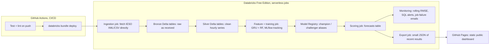

# PLAN.md — HOEP Forecasting: Portfolio → Live Production System

Status: Phase 0 (recon) complete, both open questions resolved. Nothing has been built yet.
This document is the checkpoint before Phase 1 starts.

---

## 1. What exists today (repo recon)

### 1.1 Data sources (original project)
- `PUB_PriceHOEPPredispOR_*.csv` — HOEP + hour-1/2/3 predispatch, yearly files
- `PUB_Demand_*.csv` — Ontario/market demand, yearly files
- `generation_*.csv` — generation by fuel type
- All ingested with PySpark (`01_data_ingestion.ipynb`), written to Parquet, round-tripped
  through a local single-node HDFS (`hdfs://localhost:9000`) purely as a teaching step between
  notebooks 01 and 02.

### 1.2 Feature engineering (`03_feature_engineering.ipynb`)
- Lags: `lag_1` (= current price, naming is off-by-one but not a bug), `lag_2`, `lag_3`,
  `lag_24` (daily), `lag_168` (weekly).
- Rolling stats: 24h and 168h trailing mean/std, computed on `hoep` directly (includes the
  current value, which is correct for a feature known at forecast time).
- Calendar features aligned to the **target hour**, not the forecast-origin hour
  (`hour_t_plus_1/2/3`, `day_of_week_t_plus_*`, etc.) — this is deliberate and correct, since
  calendar values for a future hour are known in advance.
- Exogenous features used as **same-timestamp actuals**: `market_demand`, `ontario_demand`,
  `nuclear`, `gas`, `hydro`, `wind`, `solar`, `biofuel`.
- Strict chronological split: train ≤ Dec 2024, val Jan–Mar 2025, test Apr 2025 (final 4 weeks).
- ML datasets built with `make_direct_dataset`, which shifts the target forward by the horizon
  and drops the trailing rows — correct, no shuffling.
- DL datasets built with `create_sequences` / `create_sequences_with_context` — 168-hour
  windows, target placed exactly `horizon` steps after the window's last timestep, validation
  and test windows stitched with the right amount of context from the prior split so no
  sequence crosses the split boundary incorrectly. This part is solid.

### 1.3 Models
| Horizon | Winner (per your notes, consistent with `07_comparison_with_IESO.ipynb` hardcoded figures) |
|---|---|
| h=1 | GRU (RMSE 29.05 vs IESO predispatch 45.25 → 35.8% better) |
| h=2 | Random Forest (RMSE 33.14, GRU 33.63) |
| h=3 | GRU (RMSE 34.56, RF 34.84) |

- GRU/LSTM: single-layer, hidden size 32 (GRU) / 64 (LSTM), dropout 0.2, Adam, early stopping
  on validation loss. `gru_param_grid` / `lstm_param_grid` each have exactly **one**
  configuration — "hyperparameter search" is nominal, not a real grid search.
- Random Forest / XGBoost: real grid search via `ParameterGrid`, retrained on train+val before
  final test evaluation — good practice.
- **Inconsistency to fix when porting**: ARIMA/SARIMA/LR/RF/XGB are all refit on train+val
  before the final test score. LSTM/GRU are **not** — the final GRU/LSTM is just the best
  checkpoint from the train/val-only run (the train+val refit block in `06_dl_models.ipynb` is
  present but commented out). Not leakage, but it means the reported GRU number used less
  training data than its competitors. Phase 2 should retrain the champion GRU on train+val
  before scoring, for a fair comparison and because production should use all available history.

### 1.4 Leakage check (what you asked Phase 0 to verify)
No leakage found in the splitting or shifting logic itself. One **production-realism** issue,
not a training-leakage bug:

> The exogenous features (`market_demand`, `ontario_demand`, `nuclear`, `gas`, `hydro`, `wind`,
> `solar`, `biofuel`) are used as the **actual, settled value for the current hour**, both for
> the ML models (as of the forecast-origin hour) and for the DL sequence's last timestep. In the
> original offline project this is fine because the historical CSVs already contain the
> finalized actuals. In a live system, IESO's actual generation/demand numbers for the hour that
> just closed are not necessarily published instantly — if they lag by more than a few minutes,
> a job that scores "1 hour ahead" right at the top of the hour would be using data it doesn't
> actually have yet.
>
> Phase 2's leakage test should explicitly check publish-timestamps on these feeds (Demand
> and generation-by-fuel), not just assume same-hour availability. If they do lag, the fix is
> either to use the most recently *published* actual (e.g. lag_1 of demand instead of lag_0) or
> to drop same-hour exogenous features from the live feature set and keep only lagged versions.
> This is the single most important thing to pin down in Phase 2 before trusting any new number.

### 1.5 Artifacts already in the repo
- `artifacts/scalers/scaler_X.pkl`, `scaler_y.pkl` — fit on train only, correct.
- `results/gru_preds.pkl`, comparison figures, a results write-up (`.docx`). These are the
  original offline results and won't be reused directly, but are a reference target for Phase 2
  sanity-checking (new numbers should land in the same ballpark once re-trained on the new
  target series).
- `data/` is DVC-tracked against a GCS remote (`gs://hoep_data6300/dvc-store`) and is **not**
  present in this clone (no GCS credentials here, and we don't need the old data pulled —
  Phase 1 ingests fresh from IESO against the new target series anyway).

---

## 2. What I found inspecting the live IESO endpoints

I could not reach `reports-public.ieso.ca` directly from this sandbox either (outbound network
here is allow-listed the same way Databricks Free Edition's is) — I inspected the site's
directory listings via web fetch instead of a direct connection. That itself is informative: if
my sandboxed fetch tool is the only way I can reach it, a `curl`/`requests` call from inside
Databricks serverless compute will very likely be blocked the same way, which is exactly the
contingency your brief already anticipated (see §3).

| Report | Format | Update cadence | History available on the live site |
|---|---|---|---|
| `RealtimeOntarioZonalPrice` | XML, one file per hour, **versioned every ~5 minutes** within the hour (`_v1`…`_v12`), base file finalizes right at hour-end | continuous | **only back to 2026-07-23** |
| `PredispHourlyOntarioZonalPrice` | XML, one file per delivery date, versioned roughly hourly (up to `_v27`), starting the evening before | continuous | **only back to 2026-08-25** |
| `DAHourlyOntarioZonalPrice` | XML, one file per date, usually `_v1`, occasionally more | daily | **only back to 2026-08-26** |
| `Demand` | CSV, **one file per calendar year**, 2002–2026 | yearly file updated continuously for current year | full history, no gap |

**Key finding — this changes Phase 1's backfill plan:** the three new Market-Renewal zonal-price
report folders only expose a rolling **~3-month window** on the public site. None of them go
back to May 1, 2025. Versions within that window are **not overwritten** — each revision is a
separate file that stays listed — so once we're ingesting live, we do **not** need to
self-archive predispatch every hour purely to avoid losing revisions; IESO does that for us for
as long as a file stays within the rolling window. But it means:

- We cannot backfill Real Time / Predispatch / Day-Ahead Ontario Zonal Price all the way back to
  May 1, 2025 from this site. The earliest we can get directly is ~2026-07-23 for realtime price,
  ~2026-08-25 for predispatch.
- Demand is fine — full history, no action needed.
- I found one more report, `RealtimeMktPriceYear` (yearly bulk CSVs back to 2010), but checked
  its contents: it's 5-minute interchange/hub pricing (Manitoba, Michigan, Minnesota, New York,
  Quebec nodes, Ontario), not the new Ontario Zonal Price product, and it stops dead on
  2025-05-01 — the exact day the old market design retired. It's not a usable substitute.
- **Resolved — no bulk historical export exists.** Checked IESO's own Data Directory
  (ieso.ca/power-data/data-directory) directly: it states the Real-Time 5-min Ontario Zonal
  Energy Price Report keeps **90 days** and the Pre-dispatch Hourly Ontario Zonal Energy Price
  Report keeps **30 days**, with no bulk/archive download for either — only daily calendar links
  into the rolling window. The page's "Archive" section covers only decommissioned legacy-market
  reports (old HOEP era), and the only data-request process mentioned anywhere is for de-identified
  smart meter data, unrelated. So there is no way to get real Ontario Zonal Price / Predispatch
  history back to May 2025 — it doesn't exist publicly, from IESO or anyone else.
- **Decision: start the modeled history wherever our own archiving begins** (backed by whatever
  the live window still holds on day one — back to ~late July/August 2026 for realtime,
  ~August 2026 for predispatch), and say so plainly in the README and dashboard rather than
  implying more history than exists. This is the honest framing for a portfolio piece: "the
  system has been accumulating live, auditable history since day X" reads better to a hiring
  manager than a backfilled dataset with a silent gap.

---

## 3. Databricks serverless network reach — tested, resolved

Two separate connectivity questions turned out to matter here, and they resolved in opposite
directions:

1. **Can Databricks serverless reach `reports-public.ieso.ca`?** Yes. Arjun ran a one-off
   `urllib.request.urlopen(...)` against `reports-public.ieso.ca/public/Demand/` from a serverless
   notebook and got back `200`. So Free Edition's trusted-domain list, whatever it is, does not
   block IESO. **Ingestion jobs can run natively as Databricks jobs** — no GitHub Actions fetch
   relay needed, which simplifies Phase 1 considerably from the earlier draft of this plan.

2. **Can I (this session) reach the Databricks workspace API directly?** No. My own sandbox's
   outbound network is allow-listed the same way Free Edition's is, and the workspace host
   (`dbc-5f682fdf-0529.cloud.databricks.com`) isn't on that list — both a raw connection and the
   Python SDK just hang/refuse. I can't run `databricks bundle deploy`, create jobs, or do
   anything else against the workspace API from here directly.

**Resolution:** pull Phase 7's "Asset Bundles + GitHub Actions, redeploy from the repo" idea
forward and use it as the deployment mechanism from Phase 1 onward, not just as later polish.
GitHub Actions runners have normal internet access and aren't behind my sandbox's restriction, so
all `databricks bundle deploy` / job-creation / job-trigger calls will happen inside an Actions
workflow, authenticated with a Databricks PAT stored as a **GitHub Actions secret**
(`DATABRICKS_HOST`, `DATABRICKS_TOKEN`) — never held in a file in this session and never pasted
in chat again after the one-time setup. I write the bundle YAML and the workflow file here; GitHub
actually executes the deploy. Arjun needs to add those two repo secrets once (exact steps given
when we get there in Phase 1).

Net effect on the architecture in §4: the "GitHub Actions, scheduled" box in the diagram below is
no longer a per-hour IESO-fetch relay — ingestion itself runs as a native Databricks job. GitHub
Actions' job in this project is CI (tests) and **CD** (deploying/updating the Databricks Asset
Bundle whenever the repo changes, and triggering one-off job runs when needed) — the diagram below
has been updated accordingly.

---

## 4. Proposed architecture (pending your answers above)

### 4.1 Table plan (Unity Catalog, Delta)
- `bronze.realtime_ontario_zonal_price` — raw XML/parsed rows as received, with ingestion
  timestamp and source filename/version kept, append-only.
- `bronze.predispatch_hourly_ontario_zonal_price` — same, **with the file's own published
  timestamp preserved**, so we always know which version was available at which wall-clock time.
- `bronze.dayahead_hourly_ontario_zonal_price`, `bronze.demand`, `bronze.generation` — same
  pattern.
- `silver.ontario_zonal_price_hourly` — one row per delivery date+hour, deduplicated against the
  latest-available-as-of version, keyed by `(delivery_date, delivery_hour)`, idempotent merge
  (`MERGE INTO`) so reruns don't duplicate.
- `silver.hoep_legacy_hourly` — the old HOEP series, kept in its own table, explicitly not
  stitched onto the zonal price series (per your instruction).
- `silver.predispatch_asof` — predispatch value **and the timestamp it was published**, so
  scoring always compares our forecast to the predispatch number that was actually available
  h hours before delivery, not a later-revised one.
- `forecasts` — forecast_time, target_hour, horizon, model_version, our_forecast, predispatch,
  day_ahead_price, actual_price (nullable until it arrives).
- `promotion_log` — every weekly promotion decision and its numbers, whatever the outcome.
- `data_quality_log` — one row per ingestion run: rows loaded, missing hours, duplicate hours,
  out-of-range prices found.

### 4.2 Job schedule (Databricks Jobs, serverless, Asset-Bundle-defined in Phase 7)
- Ingestion: hourly (bronze → silver), idempotent merge.
- Training: weekly, per your Phase 2/3 spec.
- Scoring: **open question for you** — see below.
- Monitoring/export: hourly, right after scoring.

### 4.3 Scoring cadence — your call needed in Phase 4
Hourly scoring (forecast made and stored at the top of each hour, before that hour's actual is
known) is the only version that's honest about "ahead of time" evaluation — a daily batch job
that scores 24 hours at once after the fact would let the model see same-day actuals for earlier
hours when generating later-hour features, which reintroduces exactly the kind of leakage Phase
2's test is designed to catch. I'll default to **hourly** scoring unless you tell me otherwise
in Phase 4, and will lay out the tradeoff again there with real numbers once ingestion is live.

---

## 5. Things only you can do (running list — will grow each phase)

1. ~~Decide the backfill start date question~~ — resolved, §2.
2. ~~Authenticate the Databricks CLI / give workspace access~~ — resolved, §3. (Workspace:
   `dbc-5f682fdf-0529.cloud.databricks.com`. The PAT you pasted in chat was used once to confirm
   auth and then discarded — not stored anywhere in this session or the repo.)
3. **New, for Phase 1:** add two GitHub Actions repo secrets so CD can deploy the Asset Bundle —
   `DATABRICKS_HOST` and `DATABRICKS_TOKEN`. I'll give exact click-by-click steps (Settings →
   Secrets and variables → Actions → New repository secret) when Phase 1's workflow file is ready
   for you to wire up — no need to do it before then.
4. Confirm Databricks Free Edition's job-failure notifications and SQL alerts are enough for
   Phase 5, or whether you specifically want email digests beyond that (I'll check what Free
   Edition actually exposes once we're there, since its feature set is more limited than paid
   tiers).

---

## 6. Open methodology notes to revisit in later phases
- GRU/LSTM "hyperparameter search" in the original project was a grid of one. Phase 2 should
  either do a real (small) search or openly call it a fixed, reasonable configuration rather than
  implying tuning happened.
- Same-hour exogenous actuals (§1.4) — must be resolved before Phase 2's leakage test can be
  considered to actually prove anything.
- The "36% lower RMSE than predispatch" figure is specific to the retired HOEP market and the
  April 2025 test window; it is not a promise about the new Ontario Zonal Price series, and the
  README/dashboard copy in Phase 7 should say so rather than carrying the old number forward
  unqualified.

---

**Stopping here per your instructions. Nothing beyond recon has been built.** Please answer the
two items in §2 and §3 (backfill source, and Databricks workspace access) and I'll start Phase 1.
